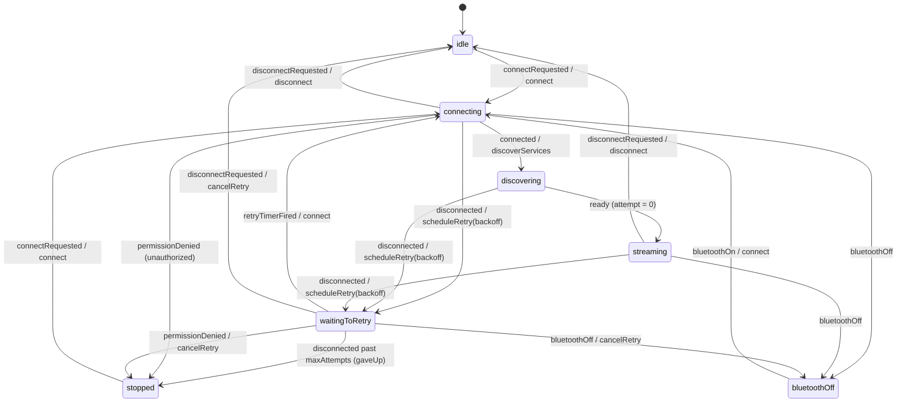

# Reconnect state machine

One pure function, `reduce(state, event) -> (state, effects)`, in
[Kotlin](../android/core/src/main/kotlin/com/example/pulselog/core/Reconnect.kt) and
[Swift](../ios/PulseLogCore/Sources/PulseLogCore/Reconnect.swift), checked against
[`spec/reconnect-cases.json`](../spec/reconnect-cases.json) step by step on both platforms.

## Backoff

For the n-th consecutive failure: `delay = floor(min(30 s, 1 s * 2^(n-1)) * (1 - 0.2 * r))`, with `r` in [0, 1)
supplied by the caller. Without jitter that is 1, 2, 4, 8, 16, 30, 30 s. Jitter only ever shortens the
delay, so the 30 s cap holds. A connection that reaches `streaming` resets the count.

`maxAttempts` is unlimited by default. A wearable the user puts down and picks up later should come back
without the user doing anything. A product that needs to give up (a one-shot cuff measurement, say) sets a
limit and gets `stopped(gaveUp)`.

## Rules that are easy to get wrong

- **Late callbacks are ignored.** BLE stacks deliver callbacks after the app has moved on (a `connected`
  after the user tapped Disconnect, a timer firing after it was cancelled). Any event that doesn't fit the
  current phase leaves the state unchanged and does nothing.
- **A user disconnect is final.** It cancels a pending retry and clears the device, so a stray
  `retryTimerFired` can't reconnect.
- **Bluetooth off is a pause, not a failure.** It doesn't count as an attempt, and turning Bluetooth back on
  reconnects at once with a fresh count.
- **Permission revoked is a stop.** Retrying without permission would fail forever, so the app stops and
  says why. Picking a device again after granting access starts over.

## Platform differences (ADR 2)

| | Android | iOS |
|---|---|---|
| `connect` | `connectGatt(autoConnect = false)`, fails after roughly 30 s with status 133 or 147 | `CBCentralManager.connect`, never times out |
| What a retry looks like | A new `BluetoothGatt` after the backoff delay; the old one is always `close()`d | A pending connection that completes whenever the device comes back, even with the app suspended |
| Background | Foreground service keeps the process alive | State restoration relaunches the app; `willRestoreState` hands back the peripheral |
| Bluetooth off | `ACTION_STATE_CHANGED` broadcast | `centralManagerDidUpdateState` with `.poweredOff` |
| Permission | Runtime permissions checked on every resume | `.unauthorized` state |
